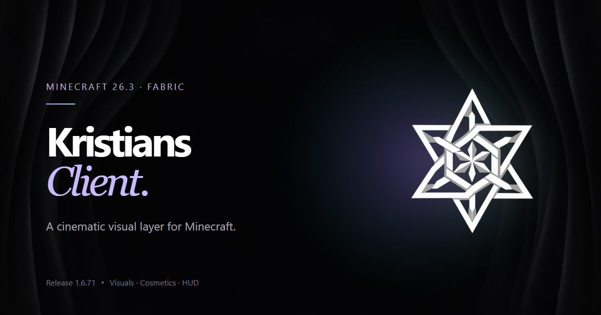

  

  
  
  

  A cinematic visual and customization client for Minecraft 26.3 Fabric.

## Highlights

- Procedural skies, atmosphere, fog tinting, bloom and animated world effects
- Custom player models, cosmetics, wings, horns, emotes and the Star Wand
- Draggable ClickGUI panels, multiple visual themes and configurable HUD modules
- Player visualization, target information, view-model controls and item effects
- Optional synchronization for friends running the same client and server mod

## Install

1. Download the [latest release](https://github.com/EineArtKristian/kristians-client/releases/latest).
2. Add the JAR to a Minecraft 26.3 Fabric profile's `mods` folder.
3. Install Fabric API in the same profile.
4. Launch Minecraft and press **K** to open Kristians Client.

Lunar users can add the JAR through the profile's Fabric mods page.

### Requirements

| Component | Version |
| --- | --- |
| Minecraft | 26.3 |
| Fabric Loader | 0.20.1 or newer |
| Fabric API | Current 26.3 build |
| Java | 25 or newer |

## Multiplayer

Local cosmetics and visual modules work without a server installation. Synchronized cosmetics and emotes require the same JAR on participating clients and the Fabric server. Follow the rules of every server you join.

## Links

- [Official website](https://eineartkristian.github.io/kristians-client/)
- [Latest download](https://github.com/EineArtKristian/kristians-client/releases/latest)
- [All releases](https://github.com/EineArtKristian/kristians-client/releases)

## License

All rights reserved. Kristians Client is not affiliated with Mojang Studios, Microsoft, Fabric or Lunar Client.
